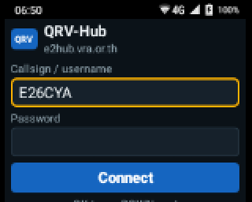
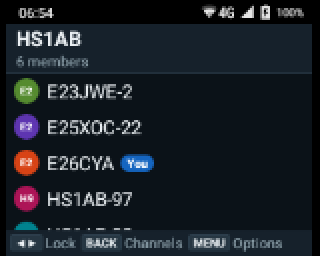
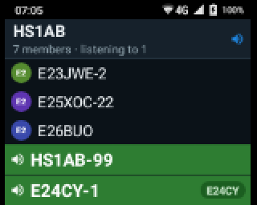
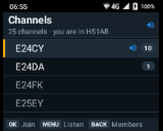
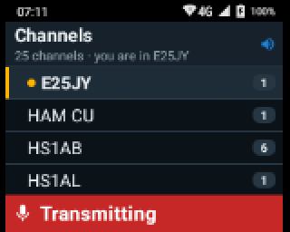
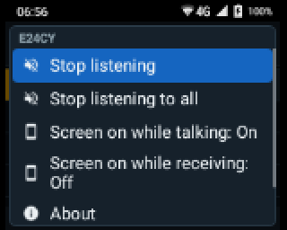
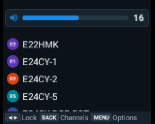
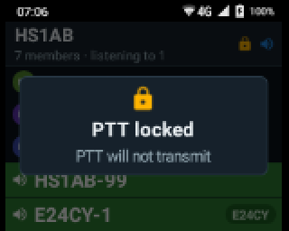
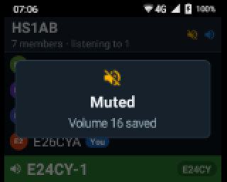
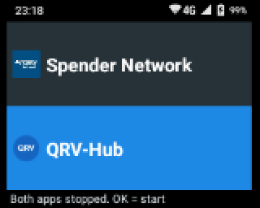

# QRV-Hub for the Spender TC-7G

**อ่านภาษาไทย: [README.md](README.md)**

QRV-Hub is a push-to-talk [Mumble](https://www.mumble.info/) client made for one
small, keys-only radio: the **Spender TC-7G** (Android 5.1, a 2-inch 160×128
screen, no touchscreen). It connects to a single Mumble server, by default the
E2Hub server at `e2hub.vra.or.th`, and is driven entirely by the radio's
buttons.

Its headline feature: **monitor several channels at once**. Stay in your own
channel to talk, and listen to other channels at the same time.

This repository holds three apps that work together on the radio, and the
Mumble library they build on:

| Folder | App | What it does |
|---|---|---|
| `qrvhub/` | **QRV-Hub** | The push-to-talk client |
| `launcher/` | **QRV-Hub Launcher** | Home screen: choose QRV-Hub or the radio's own PoC app (Spender Network), and keep the other one fully stopped so it cannot grab the PTT key |
| `display/` | **QRV-Hub Display** | Keeps the display at 240×200 so text is readable, including after every reboot |
| `humla/` | Humla | Mumble protocol library ([upstream](https://gitlab.com/quite/humla)), with small changes listed in [`humla/MODIFICATIONS.md`](humla/MODIFICATIONS.md) |

## Why QRV-Hub exists

The Spender TC-7G is a good push-to-talk radio, but out of the box it can only
really run its own PoC app. Using it on a Mumble network meant hitting one
problem after another, in the apps, the launcher and the firmware itself.
QRV-Hub is the set of fixes, measured and tested on the radio.

**Mumble apps are made for phones, not for buttoned radios**

| Problem | What QRV-Hub does |
|---|---|
| Existing Mumble apps for Android (such as Mumla) are built for a touchscreen: server lists, channel taps, pop-up dialogs. The TC-7G has no touchscreen, only keys. | Every action has a key: PTT, the volume knob, D-pad, OK, MENU, Back, two side buttons. No dialogs; nothing needs touch. |
| On a 2-inch screen their text is unreadable, and dialogs steal key focus. | A layout drawn for the radio's screen: large type, high contrast, one clear page at a time. |
| The PTT key and the side buttons are not ordinary Android keys; a normal app never sees them, and not at all with the screen off. | QRV-Hub listens to the firmware's own key signals, so PTT works in your pocket with the screen off. |
| Typing a server address, port and certificate on a keypad is impractical. | The server is built in (set once at build time); you enter only your username and password. |
| Mumble's Android library only speaks the older 1.2 protocol, without channel listening. | Listening to other channels (Mumble 1.4) is added, so you can stay in one channel and hear others. |

**The launcher is made for one radio app**

| Problem | What QRV-Hub does |
|---|---|
| The radio starts straight into its built-in PoC app (Spender Network). There is no proper way to choose another radio app. | **QRV-Hub Launcher** becomes the home screen and lets you choose QRV-Hub or Spender Network. |
| With two radio apps installed, both can react to the same PTT key and fight over the microphone and speaker. | The launcher fully stops and hides the app you are not using (as device owner), so only one app ever owns PTT. |
| After every reboot the radio returns to Spender Network, its built-in home app. | The launcher starts QRV-Hub by itself after every boot. |

**The firmware's sound is too coarse and too loud**

| Problem | What QRV-Hub does |
|---|---|
| The volume knob has only 7 steps, each about 6–7 dB apart, and the quietest step is still loud. | QRV-Hub's own volume: **30 steps**, 1 dB apart at the quiet end and 2 dB above, from −54 dB up to full. |
| At volume 0 the speaker still powers up for every incoming voice, giving a hiss and a pop. | At 0 nothing is played and the amplifier stays off: true silence. |
| Every knob click plays a beep at the system volume, which was painfully loud. | The system volume is held at 0 while nothing plays, so the beep is silent; during voice it matches the voice level. |
| The firmware's volume pop-up covers the top of the screen. | QRV-Hub's own slider covers it. |
| The firmware links media, ring and call volume into one. | QRV-Hub manages that shared volume itself and gives it back when you leave the app. |
| No quick way to mute. | Double-press the power button to mute; again to restore your level. |

**The firmware's display and controls**

| Problem | What QRV-Hub does |
|---|---|
| At the panel's native 160×128, Android apps are unusable, and the larger 240×200 setting is lost or left half-applied after a reboot (only the top-left corner shows). | **QRV-Hub Display** checks the real scaling at every boot and fixes it about one second after the boot finishes. |
| The power button is not the standard Android power key, so apps cannot see it. | QRV-Hub reads the firmware's own power-button signal; only real presses count, never the screen turning on by itself. |
| The screen timeout cannot go below about 10 s, so the screen stays on long after a call. | QRV-Hub can light the screen while you talk or receive, and turns it off 5 s later itself. |
| The LED only shows the battery. | Red while you transmit, green while someone talks, yellow while you are muted. |
| A pocket press can transmit by accident. | PTT lock on ◀/▶. |

**Battery**

| Problem | What QRV-Hub does |
|---|---|
| The Mumble library keeps the microphone recording all the time, even in push-to-talk, holds Wi-Fi at full power and pings every 5 s. | The microphone runs only while you talk (it is back within about 30 ms of a PTT press), Wi-Fi uses normal power saving, and pings are every 15 s. Measured on the radio: **72% less power** while connected and nobody is talking (162 mA → 46 mA). |

**Firmware limits that remain**

* The firmware keeps the processor awake all the time (it never deep-sleeps),
  for every app; this cannot be changed without root.
* While charging at full battery the firmware turns the screen on by itself
  every 10–15 minutes.
* The `unipro.*` controls QRV-Hub relies on are undocumented and could change
  with a firmware update.

## Key features

* Username and password only; the server is built in, and its TLS certificate
  is pinned (a changed certificate has to be trusted explicitly).
* Push-to-talk on the PTT key, working with the screen off. The microphone is
  powered only while you talk.
* **Monitor several channels at once**: stay in your own channel and listen to
  as many others as the server allows (Mumble 1.4 channel listening). Each
  speaker line shows which channel the voice comes from, the header shows how
  many channels you monitor, and they come back by themselves after a
  reconnect. PTT still transmits only to your own channel.
* Members page and channels page; join a channel with OK.
* Two **favourite channels** on the side buttons.
* Fine-grained **volume** on the knob: 30 steps (1 dB for the quietest four,
  then 2 dB), instead of the firmware's 7 coarse steps; nothing plays at 0, so
  the speaker stays silent.
* **Mute** with a double press of the power button; a second double press
  restores the previous level.
* **PTT lock** on ◀/▶, so a pocket press cannot transmit.
* **LED**: red while you transmit, green while someone talks, yellow while
  someone talks and you are muted, slow yellow flash when muted and idle.
* Optional **screen on while talking / while receiving** (off 5 s after).
* Battery: no continuous microphone, normal Wi-Fi power saving, 15 s keep-alive.

### Screenshots

Taken on the radio itself (160×128, shown at 2×) in real use on the E2Hub server, except
"Transmitting", which was taken on a test server ("TEST") so nobody on the hub heard a test key-up.

|   |   |
|---|---|
|  |  |
| **Login**: just username and password; the server is built in | **Members** of your channel |
|  |  |
| **Monitoring**: HS1AB-99 talks in your channel, E24CY-1 in the monitored channel E24CY (with its tag) | **Channels**: monitored ones have a blue speaker |
|  |  |
| **Transmitting** (PTT held) | **Menu** for a monitored channel (MENU) |
|  |  |
| **Volume**: 30 steps on the knob | **PTT lock** on ◀/▶ |
|  |  |
| **Mute**: double-press Power | **QRV-Hub Launcher**: QRV-Hub or Spender Network |

## Installing on the radio

### What you need

* The Spender TC-7G and its USB cable (developer mode and USB debugging are on from the factory).
* A computer (Windows, macOS or Linux) with **adb**, from Google's
  [Android SDK Platform-Tools](https://developer.android.com/tools/releases/platform-tools)
  (unzip it; on Windows run the commands below in that folder, typing `adb` as `adb.exe` if needed).
* The three APKs from the [latest release](https://github.com/narunc/QRV-Hub/releases/latest):
  `QRV-Hub-1.0.1.apk`, `QRV-Hub-Launcher-1.0.1.apk`, `QRV-Hub-Display-1.0.1.apk`.
  Put them in the folder where you run the commands.

### 1. Connect the radio

Plug the radio into the computer and run:

```sh
adb devices
```

The radio must be listed as `device`; it trusts the computer by itself, with
nothing to confirm on the radio. (If more than one device is connected,
add `-s <serial>` after `adb` in every command below.)

### 2. Install QRV-Hub Display (screen size)

```sh
adb install QRV-Hub-Display-1.0.1.apk
adb shell wm size 240x200
adb shell pm grant me.narun.apps.qrvhub.display android.permission.WRITE_SECURE_SETTINGS
adb shell pm grant me.narun.apps.qrvhub.display android.permission.DUMP
adb shell am start -n me.narun.apps.qrvhub.display/.MainActivity
```

The text on the radio becomes smaller and fits the screen. The two permissions
let it keep that size after every reboot; starting it once is required, or
Android will not run it at boot.

### 3. Install QRV-Hub

```sh
adb install QRV-Hub-1.0.1.apk
```

### 4. Install QRV-Hub Launcher (home screen)

```sh
adb install QRV-Hub-Launcher-1.0.1.apk
adb shell dpm set-device-owner me.narun.apps.qrvhub.launcher/.AdminReceiver
adb shell am start -n me.narun.apps.qrvhub.launcher/.HomeActivity
```

The launcher becomes the home screen and the *device owner*, which is what
lets it fully stop the radio app you are not using. Android accepts a device
owner only while the radio has **no accounts** (for example no Google
account); remove them first if `dpm` refuses.

### 5. First use

The launcher opens QRV-Hub straight away: enter your username and password
and select **Connect**. From now on the radio opens QRV-Hub by itself after
every reboot.

Press **Home** to come back to the launcher (it asks before closing QRV-Hub),
which offers **QRV-Hub** and **Spender Network**: choose with ▲/▼ and OK.

You can unplug the USB cable; it is only needed for installing.

### Updating

Download the new APKs and install them over the old ones; your login and
settings stay:

```sh
adb install -r QRV-Hub-<version>.apk
```

### Removing everything

```sh
adb shell am broadcast -a me.narun.apps.qrvhub.launcher.RELEASE
adb uninstall me.narun.apps.qrvhub.launcher
adb uninstall me.narun.apps.qrvhub
adb uninstall me.narun.apps.qrvhub.display
adb shell wm size reset
```

The first line gives the radio back its own home screen and makes Spender
Network visible again; the last one restores the original screen size.

### If you built the APKs yourself

Use the same steps with your own files
(`qrvhub/build/outputs/apk/…`, `launcher/…`, `display/…`), or run
`SERIAL=<serial> display/install-display.sh` from the repository for step 2.

## Using it

| Key | Action |
|---|---|
| **PTT** | Hold to talk (at volume 0 it first sets volume 2) |
| **Volume knob** | Volume 0–30, shown as a slider at the top |
| **Power**, once | Screen on/off |
| **Power**, twice quickly | Mute (saves the level); again: restore it |
| **◀ / ▶** | Lock / unlock PTT (amber lock icon in the header) |
| **▲ / ▼** | Scroll the members list / move in the channels list |
| **Back** | Switch between the members and channels pages |
| **OK** (channels page) | Join the selected channel |
| **MENU** | Members page: options (listening, screen options, About, Log out). Channels page: listen to / stop listening to the selected channel |
| **Side button 1 / 2**, tap | Join favourite 1 / 2 |
| **Side button 1 / 2**, hold 1 s | Save the current channel as favourite 1 / 2 |
| **Home** | Back to QRV-Hub Launcher (it asks before closing QRV-Hub) |

| LED | Meaning |
|---|---|
| Red | You are transmitting |
| Green | Someone you hear is talking |
| Yellow | Someone is talking, but you are muted |
| Slow yellow flash | Muted and idle (otherwise the firmware's own battery pattern) |

### Monitoring several channels

Stay in your own channel to talk, and monitor as many other channels as the
server allows: follow several areas or teams from one radio.

* **Start:** press Back for the channels page, select a channel, press MENU.
  Monitored channels get a blue speaker icon, and the header reads e.g.
  "10 members · listening to 2".
* **Stop:** MENU on that channel again, or **Stop listening to all** from the
  members page menu.
* **Who is speaking where:** the green line at the bottom shows each speaker,
  with a channel tag for voices from monitored channels; three lines at once,
  further speakers are listed on the last one.
* The **green LED** lights for a voice from any channel you hear.
* **PTT** goes only to the channel you are in, never to monitored ones.
* After a **reconnect** (lost signal, reboot) the same channels are monitored again.
* If the server limits listeners, a **Listen limit reached** card appears.
* Needs a Mumble 1.4 or newer server; each monitored channel adds battery use
  in proportion to how much is said there.

## Troubleshooting

| Problem | What to do |
|---|---|
| After a reboot the text is too big, or only part of the screen shows | Wait until the radio has finished starting; QRV-Hub Display fixes it within a few seconds. If not, repeat [step 2 of the installation](#2-install-qrv-hub-display-screen-size). |
| PTT does nothing and "PTT locked" appears | Press ◀ or ▶ to unlock. |
| No sound and the LED is yellow | You are muted (volume 0): double-press Power, or turn the knob up. |
| You hear a channel you are not listening to | That channel is linked to yours on the server; ask the server's administrator. |

## Building

Needs JDK 21, the Android SDK and **NDK 25.1.8937393** (newer NDKs may fail on
the old codec sources).

```sh
git clone --recursive <this repository>
cd qrv-hub
export ANDROID_HOME=~/Library/Android/sdk      # or ~/Android/Sdk on Linux

# 1. Humla's crypto library is built once, as jars
(cd humla/libs/humla-spongycastle && ../../gradlew jar)

# 2. All apps
./gradlew assembleDebug
```

APKs: `qrvhub/build/outputs/apk/debug/qrvhub-debug.apk`,
`launcher/build/outputs/apk/debug/launcher-debug.apk`,
`display/build/outputs/apk/debug/display-debug.apk`.

If you cloned without `--recursive`: `git submodule update --init --recursive`.

### Building for your own Mumble server

Change three lines in `gradle.properties`:

```properties
qrvhub.host=mumble.example.org
qrvhub.port=64738
qrvhub.serverCert=qrvhub/server/my_server.pem
```

The certificate is your server's TLS certificate in PEM format. Mumble speaks
TLS from the first byte, so you can fetch it with:

```sh
openssl s_client -connect mumble.example.org:64738 </dev/null 2>/dev/null \
  | openssl x509 > qrvhub/server/my_server.pem
```

## How it fits the radio

The TC-7G's firmware reports its hardware keys to apps as `unipro.hotkey.*`
broadcasts (also with the screen off) and lets apps drive the LED and the
screen the same way. QRV-Hub relies on these; see
[`docs/tc7g-firmware-controls.md`](docs/tc7g-firmware-controls.md). Other Android
devices do not send them, so QRV-Hub is not meant for other hardware.

## Licence and credits

GPL-3.0-or-later; see [`LICENSE`](LICENSE).
Copyright © 2026 Narun Chanyavilas <opensource@narun.me> (QRV-Hub, QRV-Hub Launcher,
QRV-Hub Display, and the Humla changes).

Built on:

* [Humla](https://gitlab.com/quite/humla) by Daniel Lublin, based on Jumble by
  Andrew Comminos (GPL-3.0); QRV-Hub's approach follows
  [Mumla](https://gitlab.com/quite/mumla).
* [Opus](https://opus-codec.org/), [Speex](https://www.speex.org/) and CELT
  (Xiph.Org), and [Spongy Castle](https://github.com/Morlunk/spongycastle),
  as git submodules.

Not affiliated with Spender or with the operators of the E2Hub server. The
firmware broadcasts used here are undocumented and may change.
