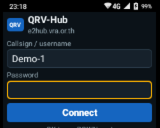
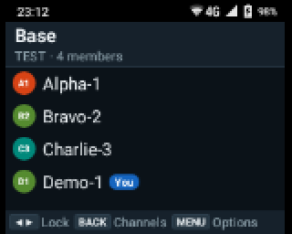
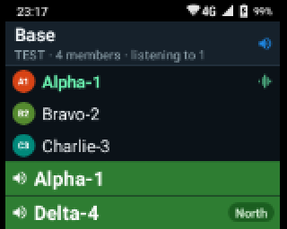
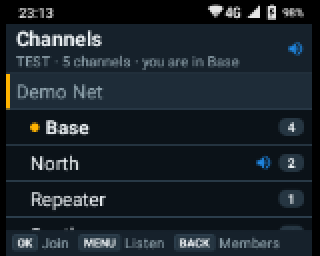
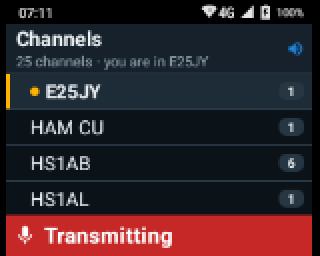
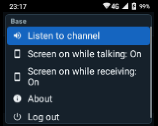
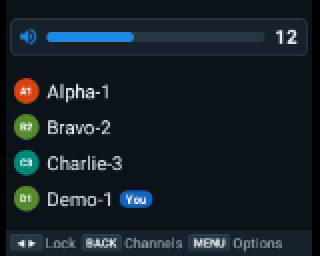
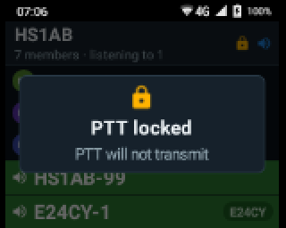
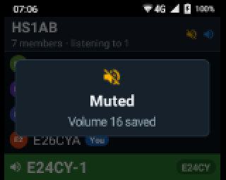
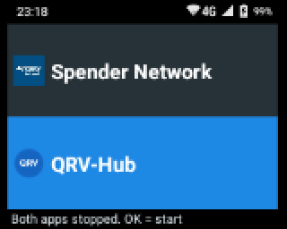

# QRV-Hub สำหรับวิทยุ Spender TC-7G

**English: [README.en.md](README.en.md)**

QRV-Hub คือแอปวิทยุสื่อสารแบบกดคีย์พูด (PTT) ผ่านเครือข่าย [Mumble](https://www.mumble.info/)
ที่ทำขึ้นสำหรับเครื่อง **Spender TC-7G** โดยเฉพาะ (Android 5.1 จอ 2 นิ้ว 160×128
ไม่มีจอสัมผัส ใช้ปุ่มกดทั้งหมด) แอปเชื่อมต่อเซิร์ฟเวอร์เดียว ค่าเริ่มต้นคือเซิร์ฟเวอร์ E2Hub
ที่ `e2hub.vra.or.th`

จุดเด่นคือ **มอนิเตอร์ (เฝ้าฟัง) หลายช่องพร้อมกันได้** อยู่ช่องของเราเพื่อคุย
และฟังช่องอื่นไปด้วยในเวลาเดียวกัน

ในชุดนี้มี 3 แอปที่ทำงานร่วมกันบนเครื่อง:

| โฟลเดอร์ | แอป | หน้าที่ |
|---|---|---|
| `qrvhub/` | **QRV-Hub** | แอปวิทยุ PTT |
| `launcher/` | **QRV-Hub Launcher** | หน้าโฮม ให้เลือกใช้ QRV-Hub หรือแอป PoC เดิมของเครื่อง (Spender Network) และปิดอีกแอปให้สนิท เพื่อไม่ให้แย่งปุ่ม PTT |
| `display/` | **QRV-Hub Display** | ตั้งขนาดหน้าจอเป็น 240×200 ให้ตัวหนังสืออ่านได้ และคงไว้ทุกครั้งที่เปิดเครื่อง |
| `humla/` | Humla | ไลบรารีโปรโตคอล Mumble (แก้ไขเล็กน้อย ดู [`humla/MODIFICATIONS.md`](humla/MODIFICATIONS.md)) |

## สารบัญ

* [วิธีติดตั้งลงวิทยุ](#วิธีติดตั้งลงวิทยุ)
  * [อัปเดตเวอร์ชันใหม่](#อัปเดตเวอร์ชันใหม่)
  * [ถอนการติดตั้งทั้งหมด](#ถอนการติดตั้งทั้งหมด)
* [ทำไมต้องมี QRV-Hub](#ทำไมต้องมี-qrv-hub)
* [ความสามารถหลัก](#ความสามารถหลัก)
  * [ภาพหน้าจอ](#ภาพหน้าจอ)
* [คู่มือการใช้งาน](#คู่มือการใช้งาน)
  * [มอนิเตอร์หลายช่องพร้อมกัน](#มอนิเตอร์หลายช่องพร้อมกัน)
* [ปัญหาที่อาจพบ](#ปัญหาที่อาจพบ)
* [สร้างไฟล์ APK เอง (สำหรับนักพัฒนา)](#สร้างไฟล์-apk-เอง-สำหรับนักพัฒนา)
* [สัญญาอนุญาตและผู้พัฒนา](#สัญญาอนุญาตและผู้พัฒนา)

## วิธีติดตั้งลงวิทยุ

### สิ่งที่ต้องมี

* วิทยุ Spender TC-7G และสาย USB (วิทยุเปิดโหมดนักพัฒนาและ USB debugging ไว้แล้วตั้งแต่โรงงาน)
* คอมพิวเตอร์ (Windows, macOS หรือ Linux) ที่มีโปรแกรม **adb** จากชุด
  [Android SDK Platform-Tools](https://developer.android.com/tools/releases/platform-tools) ของ Google
  (แตกไฟล์ zip แล้วพิมพ์คำสั่งด้านล่างในโฟลเดอร์นั้น บน Windows อาจต้องพิมพ์ `adb.exe` แทน `adb`)
* ไฟล์ APK ทั้ง 3 ไฟล์จาก [release ล่าสุด](https://github.com/narunc/QRV-Hub/releases/latest):
  `QRV-Hub-1.0.1.apk`, `QRV-Hub-Launcher-1.0.1.apk`, `QRV-Hub-Display-1.0.1.apk`
  วางไว้ในโฟลเดอร์เดียวกับที่พิมพ์คำสั่ง

### 1. เชื่อมต่อวิทยุกับคอมพิวเตอร์

เสียบสาย USB แล้วพิมพ์:

```sh
adb devices
```

ต้องเห็นวิทยุแสดงเป็น `device` วิทยุยอมรับคอมพิวเตอร์ให้เอง ไม่ต้องกดอนุญาตที่เครื่อง
(ถ้าต่ออุปกรณ์ไว้มากกว่า 1 เครื่อง ให้เติม `-s <หมายเลขเครื่อง>` ต่อจาก `adb` ในทุกคำสั่งด้านล่าง)

### 2. ติดตั้ง QRV-Hub Display (ขนาดหน้าจอ)

```sh
adb install QRV-Hub-Display-1.0.1.apk
adb shell wm size 240x200
adb shell pm grant me.narun.apps.qrvhub.display android.permission.WRITE_SECURE_SETTINGS
adb shell pm grant me.narun.apps.qrvhub.display android.permission.DUMP
adb shell am start -n me.narun.apps.qrvhub.display/.MainActivity
```

ตัวหนังสือบนวิทยุจะเล็กลงพอดีจอ สิทธิ์ 2 ตัวนี้ทำให้แอปคงขนาดหน้าจอไว้ทุกครั้งที่เปิดเครื่อง
และต้องสั่งเปิดแอปหนึ่งครั้ง ไม่เช่นนั้น Android จะไม่ให้แอปทำงานตอนเปิดเครื่อง

### 3. ติดตั้ง QRV-Hub

```sh
adb install QRV-Hub-1.0.1.apk
```

### 4. ติดตั้ง QRV-Hub Launcher (หน้าโฮม)

```sh
adb install QRV-Hub-Launcher-1.0.1.apk
adb shell dpm set-device-owner me.narun.apps.qrvhub.launcher/.AdminReceiver
adb shell am start -n me.narun.apps.qrvhub.launcher/.HomeActivity
```

Launcher จะเป็นหน้าโฮมและเป็น *device owner* ซึ่งทำให้ปิดแอปวิทยุที่ไม่ได้ใช้ได้สนิท
Android ยอมตั้ง device owner เฉพาะเมื่อในวิทยุ **ไม่มีบัญชีผู้ใช้** (เช่น Google account)
ถ้าคำสั่ง `dpm` ไม่ยอม ให้ลบบัญชีออกก่อน

### 5. เริ่มใช้งาน

Launcher จะเปิด QRV-Hub ให้ทันที ใส่ชื่อผู้ใช้และรหัสผ่าน แล้วเลือก **Connect**
ต่อไปทุกครั้งที่เปิดเครื่อง วิทยุจะเปิด QRV-Hub ให้เอง

กด **Home** เพื่อกลับไปหน้า Launcher (จะถามก่อนปิด QRV-Hub) ซึ่งให้เลือก **QRV-Hub** หรือ
**Spender Network** ด้วยปุ่ม ▲/▼ แล้วกด OK

ถอดสาย USB ได้เลย สายใช้แค่ตอนติดตั้ง

### อัปเดตเวอร์ชันใหม่

ดาวน์โหลด APK ใหม่ แล้วติดตั้งทับของเดิม ข้อมูลเข้าสู่ระบบและการตั้งค่ายังอยู่ครบ:

```sh
adb install -r QRV-Hub-<เวอร์ชัน>.apk
```

### ถอนการติดตั้งทั้งหมด

```sh
adb shell am broadcast -a me.narun.apps.qrvhub.launcher.RELEASE
adb uninstall me.narun.apps.qrvhub.launcher
adb uninstall me.narun.apps.qrvhub
adb uninstall me.narun.apps.qrvhub.display
adb shell wm size reset
```

บรรทัดแรกคืนหน้าโฮมเดิมของวิทยุและแสดง Spender Network ตามเดิม บรรทัดสุดท้ายคืนขนาดหน้าจอเดิม

## ทำไมต้องมี QRV-Hub

วิทยุ Spender TC-7G เป็นเครื่อง PTT ที่ดี แต่จากโรงงานใช้งานได้จริงแค่แอป PoC ของตัวเอง
พอจะนำมาใช้กับเครือข่าย Mumble ก็เจอปัญหาทีละเรื่อง ทั้งที่ตัวแอป หน้าโฮม และเฟิร์มแวร์
QRV-Hub คือชุดแก้ปัญหาเหล่านี้ ซึ่งวัดผลและทดสอบบนเครื่องจริงแล้ว

**แอป Mumble ทำมาสำหรับมือถือ ไม่ใช่วิทยุแบบปุ่มกด**

| ปัญหา | QRV-Hub แก้อย่างไร |
|---|---|
| แอป Mumble บน Android ที่มีอยู่ (เช่น Mumla) ออกแบบมาให้ใช้จอสัมผัส ต้องแตะเลือกเซิร์ฟเวอร์ แตะเลือกช่อง และมีหน้าต่างป๊อปอัป แต่ TC-7G ไม่มีจอสัมผัส มีแต่ปุ่ม | ทุกคำสั่งมีปุ่มกด: PTT ปุ่มหมุนเสียง ปุ่มทิศทาง OK MENU Back และปุ่มข้าง 2 ปุ่ม ไม่มีป๊อปอัป ไม่ต้องแตะจอ |
| บนจอ 2 นิ้ว ตัวหนังสืออ่านไม่ออก และป๊อปอัปแย่งการรับปุ่ม | หน้าจอออกแบบสำหรับเครื่องนี้โดยเฉพาะ ตัวใหญ่ คอนทราสต์สูง ทีละหน้าชัดเจน |
| ปุ่ม PTT และปุ่มข้างไม่ใช่ปุ่ม Android ธรรมดา แอปทั่วไปมองไม่เห็น และยิ่งตอนจอดับยิ่งไม่ได้เลย | QRV-Hub รับสัญญาณปุ่มจากเฟิร์มแวร์โดยตรง กด PTT ได้แม้เครื่องอยู่ในกระเป๋าและจอดับ |
| การพิมพ์ที่อยู่เซิร์ฟเวอร์ พอร์ต และใบรับรองด้วยปุ่มกดแทบเป็นไปไม่ได้ | ใส่เซิร์ฟเวอร์ไว้ในแอปตั้งแต่ตอนสร้าง ผู้ใช้กรอกแค่ชื่อผู้ใช้และรหัสผ่าน |
| ไลบรารี Mumble บน Android รองรับแค่โปรโตคอลรุ่น 1.2 ฟังช่องอื่นพร้อมกันไม่ได้ | เพิ่มการฟังช่องอื่น (Mumble 1.4) อยู่ช่องหนึ่งแล้วฟังช่องอื่นไปด้วยได้ |

**หน้าโฮมของเครื่องรองรับแอปวิทยุได้แอปเดียว**

| ปัญหา | QRV-Hub แก้อย่างไร |
|---|---|
| เปิดเครื่องแล้วเข้าแอป PoC เดิม (Spender Network) ทันที ไม่มีทางเลือกใช้แอปวิทยุอื่นอย่างเป็นระบบ | **QRV-Hub Launcher** เป็นหน้าโฮม ให้เลือกใช้ QRV-Hub หรือ Spender Network |
| ถ้าติดตั้งแอปวิทยุ 2 แอป ทั้งสองอาจตอบสนองต่อปุ่ม PTT เดียวกัน และแย่งไมค์กับลำโพงกัน | Launcher ปิดและซ่อนแอปที่ไม่ได้ใช้ให้สนิท (ในฐานะ device owner) จึงมีแอปเดียวที่ใช้ PTT ได้ |
| เปิดเครื่องใหม่ทุกครั้ง เครื่องจะกลับไปที่ Spender Network ซึ่งเป็นหน้าโฮมเดิม | Launcher เปิด QRV-Hub ให้เองทุกครั้งที่เปิดเครื่อง |

**เสียงของเฟิร์มแวร์หยาบและดังเกินไป**

| ปัญหา | QRV-Hub แก้อย่างไร |
|---|---|
| ปุ่มหมุนเสียงมีแค่ 7 ระดับ ห่างกันระดับละประมาณ 6–7 dB และระดับเบาสุดก็ยังดัง | ระบบเสียงของ QRV-Hub เอง **30 ระดับ** ช่วงเบาเพิ่มทีละ 1 dB ช่วงถัดไปทีละ 2 dB ตั้งแต่ −54 dB จนถึงดังสุด |
| ที่ระดับ 0 พอมีเสียงเข้า ลำโพงยังเปิดทำงาน มีเสียงซ่าและเสียงป๊อก | ที่ระดับ 0 ไม่เล่นเสียงเลยและไม่เปิดแอมป์ เงียบสนิทจริง |
| หมุนปุ่มเสียงทุกครั้งมีเสียงบี๊บดังตามระดับเสียงของระบบ ซึ่งดังมาก | ตั้งเสียงระบบไว้ที่ 0 ตอนไม่มีเสียงพูด เสียงบี๊บจึงเงียบ และตอนมีคนพูดจะเบาเท่าเสียงพูด |
| ป๊อปอัปปรับเสียงของเฟิร์มแวร์บังหัวจอ | แถบเสียงของ QRV-Hub ปิดทับไว้ |
| เฟิร์มแวร์ผูกเสียงสื่อ เสียงเรียกเข้า และเสียงสนทนาไว้ระดับเดียวกัน | QRV-Hub จัดการระดับเสียงร่วมนี้เอง และคืนค่าเดิมเมื่อออกจากแอป |
| ไม่มีวิธีปิดเสียงด่วน | กดปุ่ม Power เร็ว ๆ 2 ครั้งเพื่อปิดเสียง กดอีก 2 ครั้งเพื่อคืนระดับเดิม |

**หน้าจอและการควบคุมของเฟิร์มแวร์**

| ปัญหา | QRV-Hub แก้อย่างไร |
|---|---|
| ที่ความละเอียดจริงของจอ 160×128 แอป Android ใช้งานไม่ได้ และค่า 240×200 ที่ตั้งไว้มักหายหรือใช้ได้แค่ครึ่งเดียวหลังเปิดเครื่อง (เห็นแค่มุมซ้ายบน) | **QRV-Hub Display** ตรวจการแสดงผลจริงทุกครั้งที่เปิดเครื่อง และแก้ให้ภายในประมาณ 1 วินาทีหลังบูตเสร็จ |
| ปุ่ม Power ไม่ใช่ปุ่ม Power มาตรฐานของ Android แอปจึงมองไม่เห็น | QRV-Hub อ่านสัญญาณปุ่ม Power จากเฟิร์มแวร์โดยตรง นับเฉพาะการกดจริง ไม่นับตอนที่จอเปิดเองหรือดับเอง |
| ตั้งเวลาปิดจอได้ไม่ต่ำกว่าประมาณ 10 วินาที จอจึงเปิดค้างนานหลังคุย | QRV-Hub เลือกให้เปิดจอขณะพูดหรือขณะรับได้ แล้วดับจอเองหลัง 5 วินาที |
| ไฟ LED แสดงได้แค่สถานะแบตเตอรี่ | แดงเมื่อเราส่ง เขียวเมื่อมีคนพูด เหลืองเมื่อปิดเสียงอยู่ |
| ปุ่มอาจโดนกดในกระเป๋าจนส่งเสียงออกไปโดยไม่ตั้งใจ | ล็อก PTT ด้วยปุ่ม ◀/▶ |

**แบตเตอรี่**

| ปัญหา | QRV-Hub แก้อย่างไร |
|---|---|
| ไลบรารี Mumble เปิดไมค์บันทึกเสียงตลอดเวลาแม้ในโหมด PTT ล็อก Wi-Fi ไว้ที่กำลังเต็ม และส่งสัญญาณรักษาการเชื่อมต่อทุก 5 วินาที | ไมค์ทำงานเฉพาะตอนพูด (พร้อมใช้ภายในประมาณ 30 มิลลิวินาทีหลังกด PTT) Wi-Fi ประหยัดพลังงานตามปกติ และส่งสัญญาณทุก 15 วินาที วัดบนเครื่องจริง: ขณะเชื่อมต่อและไม่มีใครพูด **ใช้ไฟน้อยลง 72%** (162 mA → 46 mA) |

**ข้อจำกัดของเฟิร์มแวร์ที่ยังแก้ไม่ได้**

* เฟิร์มแวร์ไม่ยอมให้หน่วยประมวลผลเข้าโหมดหลับลึกเลย ไม่ว่าจะใช้แอปใด แก้ไม่ได้หากไม่ root เครื่อง
* ขณะชาร์จจนแบตเต็ม เฟิร์มแวร์จะเปิดจอเองทุก 10–15 นาที
* คำสั่งควบคุม `unipro.*` ที่ QRV-Hub ใช้ไม่มีเอกสารทางการ และอาจเปลี่ยนเมื่ออัปเดตเฟิร์มแวร์

## ความสามารถหลัก

* เข้าสู่ระบบด้วยชื่อผู้ใช้และรหัสผ่านเท่านั้น เซิร์ฟเวอร์อยู่ในแอป และตรวจใบรับรองของเซิร์ฟเวอร์ (ถ้าใบรับรองเปลี่ยน ต้องยืนยันเอง)
* กด PTT คุยได้แม้จอดับ ไมค์ทำงานเฉพาะตอนพูด
* **มอนิเตอร์หลายช่องพร้อมกัน**: อยู่ช่องของเรา และเฝ้าฟังช่องอื่นได้หลายช่องเท่าที่เซิร์ฟเวอร์อนุญาต
  (Mumble 1.4) มีแถบบอกว่าเสียงมาจากช่องไหน หัวจอบอกจำนวนช่องที่ฟังอยู่
  และเชื่อมต่อใหม่เมื่อไรก็กลับมาฟังช่องเดิมให้เอง กด PTT แล้วเสียงไปเฉพาะช่องของเรา
* หน้ารายชื่อสมาชิกและหน้ารายชื่อช่อง เลือกเข้าช่องได้ด้วยปุ่ม OK
* **ช่องโปรด 2 ช่อง** บนปุ่มข้าง
* ปรับเสียงละเอียด **30 ระดับ** ที่ระดับ 0 เงียบสนิท
* **ปิดเสียง** ด้วยการกดปุ่ม Power 2 ครั้ง กดอีกรอบเพื่อคืนเสียงเดิม
* **ล็อก PTT** ด้วยปุ่ม ◀/▶ กันการกดโดยไม่ตั้งใจ
* **ไฟ LED** แดง/เขียว/เหลือง บอกสถานะการพูด การรับ และการปิดเสียง
* เลือกได้ว่าจะ **เปิดจอขณะพูด / ขณะรับ** (ดับเองหลัง 5 วินาที)
* ประหยัดแบตเตอรี่: ไมค์ไม่เปิดค้าง Wi-Fi ประหยัดพลังงานปกติ ส่งสัญญาณรักษาการเชื่อมต่อทุก 15 วินาที

### ภาพหน้าจอ

ภาพจากวิทยุจริง (จอ 160×128 ขยาย 2 เท่า) ขณะใช้งานจริงบนเซิร์ฟเวอร์ E2Hub

<p>


</p>

* ซ้าย: **เข้าสู่ระบบ** ใส่แค่ชื่อผู้ใช้และรหัสผ่าน เซิร์ฟเวอร์อยู่ในแอปแล้ว
* ขวา: **รายชื่อสมาชิก** ในช่องที่เราอยู่

<p>


</p>

* ซ้าย: **มอนิเตอร์หลายช่อง** HS1AB-99 พูดในช่องเรา E24CY-1 พูดจากช่อง E24CY ที่ฟังอยู่ (มีป้ายชื่อช่อง)
* ขวา: **รายชื่อช่อง** ช่องที่ฟังอยู่มีรูปลำโพงสีน้ำเงิน

<p>


</p>

* ซ้าย: **กำลังส่งเสียง** ขณะกด PTT
* ขวา: **เมนู** ของช่องที่ฟังอยู่ (ปุ่ม MENU)

<p>


</p>

* ซ้าย: **ปรับเสียง** 30 ระดับด้วยปุ่มหมุน
* ขวา: **ล็อก PTT** ด้วยปุ่ม ◀/▶

<p>


</p>

* ซ้าย: **ปิดเสียง** ด้วยการกดปุ่ม Power 2 ครั้ง
* ขวา: **QRV-Hub Launcher** เลือก QRV-Hub หรือ Spender Network

## คู่มือการใช้งาน

### เข้าสู่ระบบ

ครั้งแรกให้ใส่ **ชื่อผู้ใช้ (Username)** และ **รหัสผ่าน (Password)** แล้วกด Connect
แอปจะจำไว้และเชื่อมต่อเองทุกครั้งที่เปิด ไม่ต้องตั้งค่าเซิร์ฟเวอร์

ถ้าขึ้นข้อความ **"Server certificate changed"** แปลว่าใบรับรองของเซิร์ฟเวอร์เปลี่ยน
ให้ตรวจสอบกับผู้ดูแลเซิร์ฟเวอร์ก่อน ถ้าถูกต้องให้กด MENU แล้วเลือก **Trust new certificate**

### ปุ่มต่าง ๆ

| ปุ่ม | การทำงาน |
|---|---|
| **PTT** | กดค้างเพื่อพูด ปล่อยเพื่อฟัง (ถ้าเสียงอยู่ที่ 0 จะตั้งเสียงเป็น 2 ให้ก่อน) |
| **ปุ่มหมุนเสียง** | ปรับเสียง 0–30 มีแถบแสดงระดับเสียงด้านบนจอ |
| **ปุ่ม Power** กดครั้งเดียว | เปิด/ปิดหน้าจอ |
| **ปุ่ม Power** กดเร็ว ๆ 2 ครั้ง | ปิดเสียง (จำระดับเสียงไว้) กด 2 ครั้งอีกรอบเพื่อคืนเสียงเดิม |
| **◀ / ▶** | ล็อก / ปลดล็อก PTT (มีรูปแม่กุญแจสีส้มที่หัวจอเมื่อล็อก) |
| **▲ / ▼** | เลื่อนรายชื่อสมาชิก / เลื่อนเลือกช่อง |
| **Back** | สลับหน้า รายชื่อสมาชิก ↔ รายชื่อช่อง |
| **OK** (หน้ารายชื่อช่อง) | เข้าช่องที่เลือก |
| **MENU** | หน้าสมาชิก: ตัวเลือก (การฟังช่องอื่น เปิดจอขณะพูด/ขณะรับ เกี่ยวกับแอป ออกจากระบบ) · หน้ารายชื่อช่อง: เริ่ม/หยุดฟังช่องที่เลือก |
| **ปุ่มข้าง 1 / 2** กดครั้งเดียว | ไปช่องโปรด 1 / 2 |
| **ปุ่มข้าง 1 / 2** กดค้าง 1 วินาที | บันทึกช่องที่อยู่ตอนนี้เป็นช่องโปรด 1 / 2 |
| **Home** | กลับไปหน้า QRV-Hub Launcher (จะถามก่อนปิด QRV-Hub) |

### ไฟ LED

| ไฟ | ความหมาย |
|---|---|
| แดง | เรากำลังส่งเสียง |
| เขียว | มีคนกำลังพูดในช่องที่เราได้ยิน |
| เหลือง | มีคนกำลังพูด แต่เราปิดเสียงอยู่ |
| เหลืองกะพริบช้า ๆ | ปิดเสียงอยู่และไม่มีใครพูด (ปกติจะเป็นไฟแสดงแบตเตอรี่ของเครื่อง) |

### เสียง

* ปุ่มหมุนปรับได้ 30 ระดับ ระดับ 1–4 เพิ่มทีละ 1 dB สำหรับฟังเบา ๆ ระดับถัดไปเพิ่มทีละ 2 dB
* ที่ระดับ **0 คือปิดเสียง** ลำโพงจะไม่ทำงานเลย จึงไม่มีเสียงซ่า
* ปิดเสียงอยู่แล้วหมุนเพิ่ม เสียงจะเริ่มที่ระดับ 1
* ถ้าเสียบหูฟัง เสียงจะไปที่หูฟังเอง และใช้ไมค์ของหูฟัง

### มอนิเตอร์หลายช่องพร้อมกัน

อยู่ช่องของเราเพื่อคุย แล้วเฝ้าฟังช่องอื่นไปด้วยกี่ช่องก็ได้ตามที่เซิร์ฟเวอร์อนุญาต
เหมาะกับการติดตามหลายพื้นที่หรือหลายทีมพร้อมกันจากเครื่องเดียว

* **เริ่มฟัง:** กด Back ไปหน้ารายชื่อช่อง เลือกช่อง แล้วกด MENU
  ช่องที่ฟังอยู่จะมีรูปลำโพงสีน้ำเงิน และหัวจอแสดงเช่น "10 members · listening to 2"
* **หยุดฟัง:** กด MENU ที่ช่องนั้นอีกครั้ง หรือเลือก **Stop listening to all** จากเมนูหน้าสมาชิก
* **รู้ว่าใครพูดจากช่องไหน:** แถบสีเขียวด้านล่างแสดงชื่อคนพูด พร้อมป้ายชื่อช่องสำหรับเสียงที่มาจากช่องที่ฟัง
  แสดงพร้อมกันได้ 3 แถว ถ้ามีคนพูดมากกว่านั้น แถวสุดท้ายจะรวมชื่อที่เหลือไว้
* **ไฟเขียว** ติดเมื่อมีคนพูดในช่องใดก็ตามที่เราได้ยิน
* **PTT** ส่งเสียงไปเฉพาะช่องที่เราอยู่ ไม่ไปถึงช่องที่แค่ฟัง
* **เชื่อมต่อใหม่** (เช่น สัญญาณหลุด หรือเปิดเครื่องใหม่) แอปจะกลับไปฟังช่องเดิมให้เอง
* ถ้าเซิร์ฟเวอร์จำกัดจำนวนช่องที่ฟังได้ จะขึ้นข้อความ **Listen limit reached**
* ต้องใช้เซิร์ฟเวอร์ Mumble รุ่น 1.4 ขึ้นไป และทุกช่องที่ฟังเพิ่มก็ใช้แบตเตอรี่เพิ่มตามปริมาณเสียง

หมายเหตุ: ถ้าผู้ดูแลเซิร์ฟเวอร์ **เชื่อม (link)** ช่องไว้ด้วยกัน จะได้ยินเสียงของช่องที่เชื่อมกันเสมอ
และเสียงที่เราพูดก็จะไปถึงช่องนั้นด้วย

### หน้าจอ

ใน MENU มีตัวเลือก
* **Screen on while talking** เปิดจอขณะกด PTT แล้วดับหลังปล่อย 5 วินาที
* **Screen on while receiving** เปิดจอขณะมีคนพูด แล้วดับหลังเงียบ 5 วินาที

ทั้งสองแบบจะดับจอเองเฉพาะกรณีที่จอดับอยู่ก่อน ถ้ากำลังใช้งานจออยู่ จะดับตามเวลาปกติ

### แบตเตอรี่

ไมค์ทำงานเฉพาะตอนกด PTT และแอปส่งสัญญาณรักษาการเชื่อมต่อทุก 15 วินาที
สิ่งที่ใช้แบตมากที่สุดคือ **เสียงที่รับเข้ามา** ยิ่งฟังหลายช่องที่มีคนพูดเยอะ แบตยิ่งหมดเร็ว

## ปัญหาที่อาจพบ

| อาการ | วิธีแก้ |
|---|---|
| หลังเปิดเครื่อง ตัวหนังสือใหญ่เกิน / จอแสดงไม่ครบ | รอให้เปิดเครื่องเสร็จ QRV-Hub Display จะแก้ให้ภายในไม่กี่วินาที ถ้ายังไม่หาย ทำ[ขั้นตอนที่ 2 ของวิธีติดตั้ง](#2-ติดตั้ง-qrv-hub-display-ขนาดหน้าจอ)อีกครั้ง |
| กด PTT แล้วไม่ส่งเสียง มีข้อความ "PTT locked" | กด ◀ หรือ ▶ เพื่อปลดล็อก |
| ไม่ได้ยินเสียง ไฟเหลือง | ปิดเสียงอยู่ (ระดับ 0) กด Power 2 ครั้ง หรือหมุนเพิ่มเสียง |
| ได้ยินเสียงจากช่องที่ไม่ได้ฟัง | ช่องนั้นถูกเชื่อม (link) กับช่องเราที่เซิร์ฟเวอร์ ติดต่อผู้ดูแลเซิร์ฟเวอร์ |

## สร้างไฟล์ APK เอง (สำหรับนักพัฒนา)

### สร้างไฟล์ APK

ต้องมี JDK 21, Android SDK และ **NDK 25.1.8937393** (NDK รุ่นใหม่กว่าอาจคอมไพล์ไม่ผ่าน)

```sh
git clone --recursive <ที่อยู่ repository นี้>
cd qrv-hub
export ANDROID_HOME=~/Library/Android/sdk      # บน Linux มักเป็น ~/Android/Sdk

# 1. สร้างไลบรารีเข้ารหัสของ Humla (ทำครั้งเดียว)
(cd humla/libs/humla-spongycastle && ../../gradlew jar)

# 2. สร้างทุกแอป
./gradlew assembleDebug
```

ไฟล์ที่ได้: `qrvhub/build/outputs/apk/debug/qrvhub-debug.apk`,
`launcher/build/outputs/apk/debug/launcher-debug.apk`,
`display/build/outputs/apk/debug/display-debug.apk`

ติดตั้งลงวิทยุด้วยขั้นตอนเดียวกับ [วิธีติดตั้งลงวิทยุ](#วิธีติดตั้งลงวิทยุ) โดยใช้ไฟล์ที่สร้างเอง
หรือใช้สคริปต์ `SERIAL=<หมายเลขเครื่อง> display/install-display.sh` แทนขั้นตอนที่ 2

### ใช้กับเซิร์ฟเวอร์ Mumble ของตัวเอง

แก้ 3 บรรทัดใน `gradle.properties` แล้วสร้าง APK ใหม่:

```properties
qrvhub.host=mumble.example.org
qrvhub.port=64738
qrvhub.serverCert=qrvhub/server/my_server.pem
```

ไฟล์ใบรับรอง (PEM) ของเซิร์ฟเวอร์ดึงได้ด้วยคำสั่ง:

```sh
openssl s_client -connect mumble.example.org:64738 </dev/null 2>/dev/null \
  | openssl x509 > qrvhub/server/my_server.pem
```

## สัญญาอนุญาตและผู้พัฒนา

GPL-3.0-or-later ดูไฟล์ [`LICENSE`](LICENSE)
Copyright © 2026 Narun Chanyavilas <opensource@narun.me>

สร้างบน [Humla](https://gitlab.com/quite/humla) (Daniel Lublin, ต่อยอดจาก Jumble ของ
Andrew Comminos) และ [Mumla](https://gitlab.com/quite/mumla) ใช้ codec Opus, Speex,
CELT (Xiph.Org) และ Spongy Castle

โครงการนี้ไม่ได้เกี่ยวข้องกับ Spender หรือผู้ดูแลเซิร์ฟเวอร์ E2Hub
คำสั่งของเฟิร์มแวร์ที่แอปใช้ไม่มีเอกสารทางการ และอาจเปลี่ยนได้ในอนาคต
